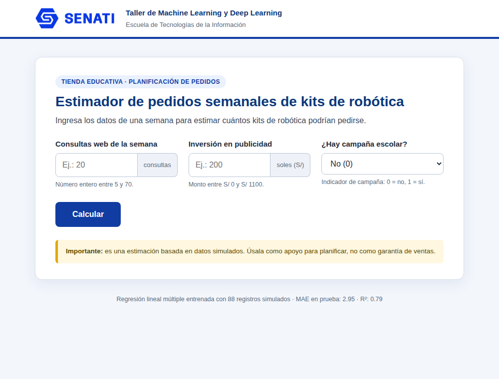
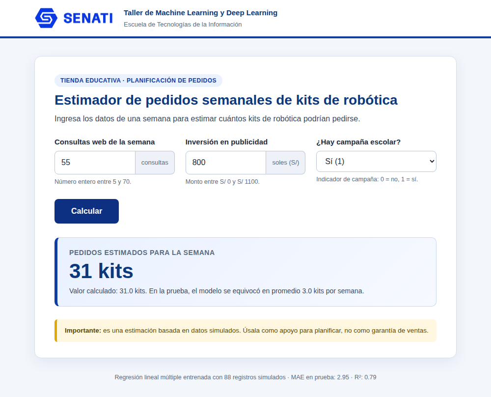
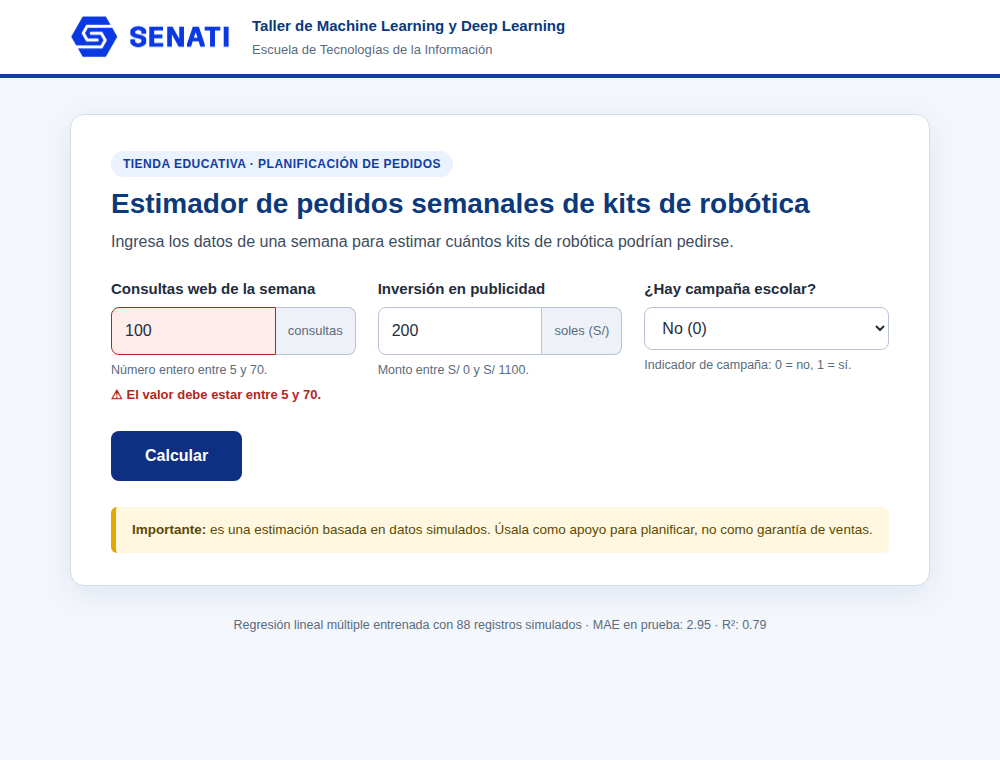

# Caso 1 · Estimador de pedidos semanales de kits de robótica

Una tienda educativa quiere anticipar los pedidos semanales de kits de robótica a partir de las consultas web, la inversión en publicidad y si hay campaña escolar.

> Taller de Machine Learning y Deep Learning · SENATI · Escuela de Tecnologías de la Información.
> Los datos son **simulados**, no registros reales.

## Variables

| Columna | Significado | Rango válido |
|---|---|---|
| `consultas_web` | consultas recibidas en la semana | 5 a 70 |
| `inversion_publicidad_soles` | inversión en publicidad (S/) | 0 a 1100 |
| `campana_escolar` | 1 = hay campaña escolar, 0 = no | 0 / 1 |
| `pedidos_kits` (**y**) | kits pedidos en la semana | — |

## Resultados

- Separación: 88 filas de entrenamiento / 22 de prueba (80 % / 20 %, `random_state=42`)
- **MAE:** 2.95 (kits/semana) · **R²:** 0.791

| Prueba obligatoria | Resultado de la página |
|---|---|
| 20 consultas, S/ 200, sin campaña | 10 kits (9.8) |
| 55 consultas, S/ 800, con campaña | 31 kits (31.0) |

## Capturas







## Cómo ejecutarlo

```bash
pip install -r requirements.txt
python entrenar.py     # entrena y crea modelo.json y modelo.pkl
python pruebas.py      # pruebas obligatorias y de validación
python app.py          # abre http://127.0.0.1:5000
```

## Contenido

| Archivo | Descripción |
|---|---|
| `datos.csv` | datos simulados del caso |
| `01_Caso_para_desarrollar.ipynb` | cuaderno desarrollado y ejecutado |
| `entrenar.py` | lectura, limpieza, separación 80/20, entrenamiento y métricas |
| `modelo.json` | coeficientes y métricas que usa la web |
| `modelo.pkl` | modelo de scikit-learn (respaldo; depende de la versión instalada) |
| `app.py`, `templates/`, `static/` | aplicación Flask (HTML y CSS, sin JavaScript) |
| `pruebas.py`, `pruebas_resultados.txt` | pruebas y su resultado |
| `capturas/` | capturas de la aplicación |
| `EXPLICACION_Y_CONCLUSIONES.md` | explicación de 10 líneas y límites del modelo |
